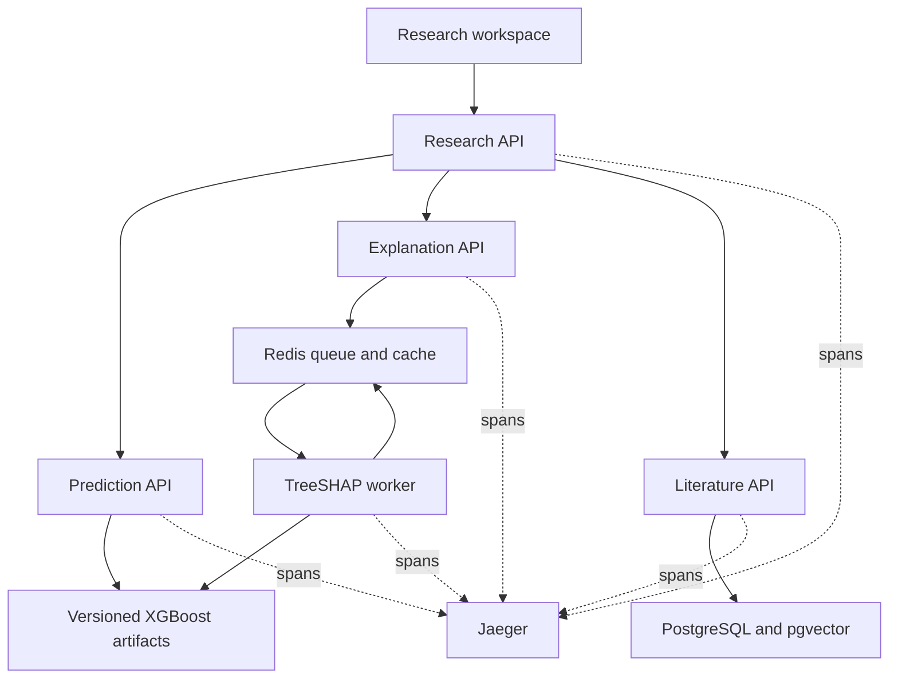

# Architecture

The research API serves the static frontend and proxies only the fixed catalog
operations needed to select valid model identifiers. The browser uses one origin.
`POST /research` returns JSON. `POST /research/stream` returns newline-delimited
JSON progress events followed by a result or error event. Progress describes
completed backend stages; it does not simulate a percentage.

The workflow validates identifiers with prediction, queues an explanation,
retrieves literature, then polls the explanation with a bounded number of
attempts. A cold worker can finish after this polling window; another submission
can use its cached result. Prediction failure stops the workflow. Explanation
or retrieval failures produce partial evidence with explicit limitations.

HTTP client spans propagate W3C `traceparent` headers. Explanation submission
serializes only trace context and a bounded request identifier into RQ arguments.
The worker creates its provider after the fork and exports its span before the
job process exits. Duplicate submissions that reuse a job do not create another
worker span; the worker remains attached to the original submitter's trace.
This also applies to cached results.

Each API exposes `/metrics`. HTTP metric labels use route templates, not raw
paths, questions, cell lines, drug names, or job IDs. Worker processing aggregates
live in Redis so RQ process exits do not discard them. A scrape failure reports
queue metrics as unavailable instead of manufacturing a zero queue depth.
Prometheus scrapes the four APIs and Grafana provisions a system dashboard.

The default workflow does not call an LLM. Its summary identifies retrieved
titles and model outputs without interpreting abstracts as proof of a biological
mechanism. LLM latency, tokens, and external-model cost are therefore marked as
not applicable in the dashboard. Phase 4 synthesis and its semantic evaluation
remain separate work.

Local monitoring stores data ephemerally and binds UIs to loopback. A production
deployment needs authenticated monitoring, persistent telemetry retention,
managed Redis/PostgreSQL, immutable artifact storage, and independently scaled
workers. Keep one Uvicorn process per container; this metrics registry does not
aggregate multiple web processes within a container.
